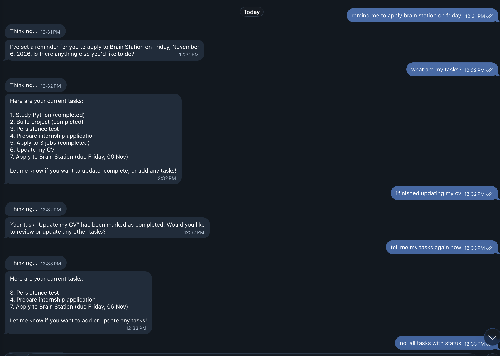

# AI Executive Assistant

A personal AI agent you talk to through **Telegram** or the **command line**. It holds context-aware conversations using the OpenAI API, remembers past messages, and manages your task list when you ask in plain language, for example *"remind me to apply to Brain Station on Friday"*.



## Why I built this

I'm applying to many companies, and job searching means a lot of repeated work: writing emails, tracking applications and remembering what to do next. I wanted a personal assistant that I control, instead of giving my personal accounts to a public AI tool. I also wanted to learn how AI agents work by building one myself.

Version 1 handles AI conversation and task tracking through Telegram. Version 2 will connect Gmail and help with job applications.

## What it does

- **Plain-language task management (AI tool calling):** say *"remind me to…"* or *"I finished…"* and the AI decides to add, list or complete a task. It also turns words like "Friday" into a real due date.
- **AI chat:** ask questions or get help writing, for example a thank-you email after an interview.
- **Memory:** conversation history is saved to a JSON file and restored on restart. Only the 20 most recent messages are sent to OpenAI, to keep responses fast and costs low.
- **Task tracking:** tasks have a unique ID and an optional due date, and are saved to a JSON file. Slash commands also work.
- **Two interfaces:** the same features work in Telegram (on your phone) and in the terminal.


## Commands

| Command | What it does |
|---|---|
| `/tasks` | Show all tasks |
| `/addtask <title>` | Add a task |
| `/done <number>` | Mark a task as completed |
| `/delete <number>` | Delete a task |
| `/help` | Show the commands |
| any other message | Chat with the AI, or ask it to manage your tasks |

The terminal version also has `/history`, `/clear` and `/exit`.

## How it works

```text
You (Telegram or terminal)
        │
        ▼
 bot.py / app.py        ← receives your message, decides what to do
        │
        ├── a task command  → assistant/tasks/  → saved in data/tasks.json
        │
        └── a normal message → assistant/llm.py → OpenAI API (message + tool menu)
                                       │
                         OpenAI asks for a tool, e.g. complete_task
                                       │
                               assistant/tools.py runs it → data/tasks.json
                                       │
                         result goes back to OpenAI → final reply to you
```

**Tool calling:** the app sends OpenAI a "menu" of tools (`add_task`, `list_tasks`, `complete_task`) with a description of each. OpenAI reads the user's message, picks the right tool and asks the app to run it. OpenAI never touches the files itself: the app's own code does the work and stays in control.

| File | Role |
|---|---|
| `bot.py` | Telegram interface |
| `app.py` | Command-line interface |
| `assistant/llm.py` | Sends messages to OpenAI and runs the tool-calling loop |
| `assistant/tools.py` | The tools the AI can ask for, and the code that runs them |
| `assistant/memory.py` | Saves and loads conversation history |
| `assistant/tasks/` | Task model, task logic and JSON storage |

## How to run it

**1. Download the project and install what it needs**

```bash
git clone https://github.com/FahmyIslam12/ai-executive-assistant.git
cd ai-executive-assistant
python3 -m venv .venv
source .venv/bin/activate
pip install -r requirements.txt
```

**2. Add your keys.** Create a file named `.env` in the project folder:

```env
OPENAI_API_KEY=your_openai_api_key
TELEGRAM_BOT_TOKEN=your_telegram_bot_token
```

Get a bot token from [@BotFather](https://t.me/BotFather) on Telegram. The `.env` file is listed in `.gitignore`, so your keys are never uploaded.

**3. Start it**

```bash
python bot.py    # Telegram bot
python app.py    # terminal version
```

## Security

- API keys are stored in `.env`, not in the code.
- The bot hides request URLs from its logs, because Telegram URLs contain the bot token.
- Account access stays in this app. OpenAI only receives the text needed for each request.

## Current limitations

- Built for one user: all Telegram chats share the same memory and task list.
- Reminders are saved as tasks with due dates, but the bot doesn't send notifications yet.
- AI replies aren't fully predictable: it may choose to show only unfinished tasks unless asked for all.
- Data is stored in JSON files, not a database.
- No automated tests yet.

## Roadmap (version 2)

- [ ] Gmail integration: read, draft and send emails
- [ ] Help with job applications
- [x] Natural-language task management with AI tool calling
- [ ] Send reminder notifications on the due date
- [ ] Separate memory for each Telegram user
- [ ] Automated tests
- [ ] Test a local AI model (Ollama) for more privacy

## Tech stack

Python · OpenAI API · python-telegram-bot · JSON · Git