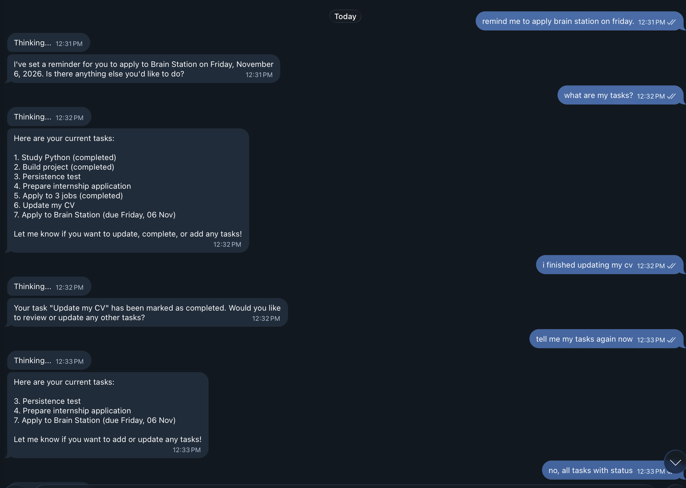
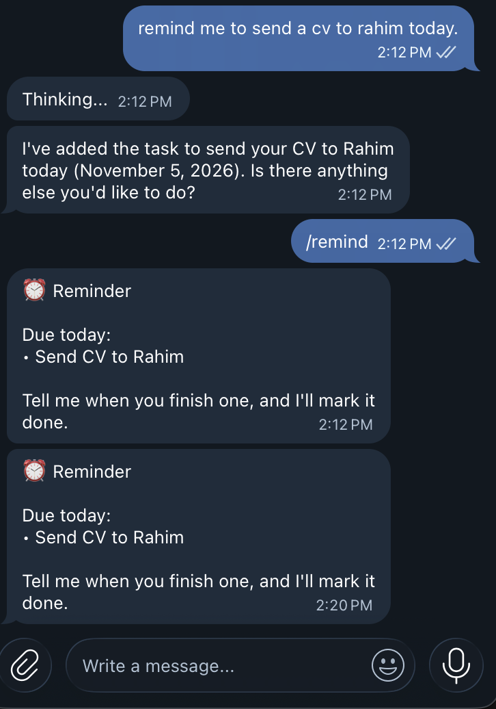
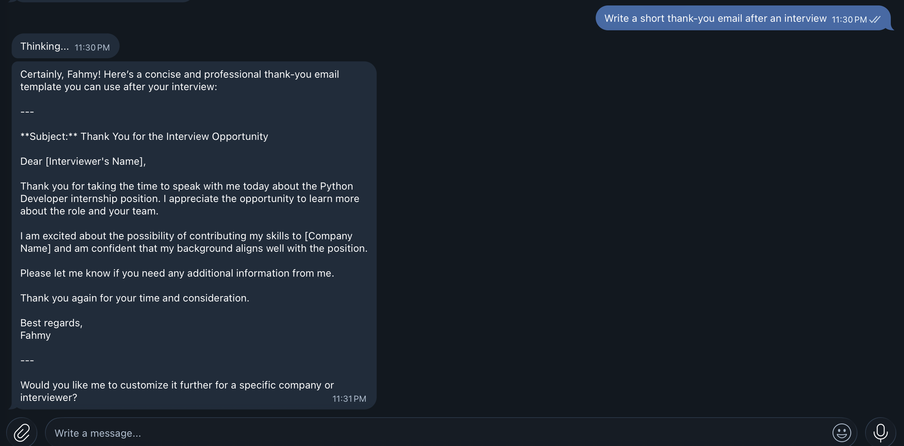

# AI Executive Assistant

A personal AI agent you talk to through **Telegram** or the **command line**. It holds context-aware conversations using the OpenAI API, remembers past messages, and manages your task list when you ask in plain language, for example *"remind me to apply to Brain Station on Friday"*. Every morning it messages you about tasks that are due, and it works with your Gmail: it finds and summarizes emails, and drafts replies and tailored job applications that are sent only after you approve them.



## Why I built this

I'm applying to many companies, and job searching means a lot of repeated work: writing emails, tracking applications and remembering what to do next. I wanted a personal assistant that I control, instead of giving my personal accounts to a public AI tool. I also wanted to learn how AI agents work by building one myself.

Version 1 handles AI conversation, task tracking and reminders. Version 2 adds Gmail: reading and summarizing emails, and drafting replies and tailored job applications that are sent only after my approval.

## What it does

- **Plain-language task management (AI tool calling):** say *"remind me to…"* or *"I finished…"* and the AI decides to add, list or complete a task. It also turns words like "Friday" into a real due date.
- **Daily reminders:** every morning at 9:00 (Bangladesh time) the bot messages you first, listing tasks due today and overdue tasks. `/remind` checks right away.
- **Gmail: read and summarize:** *"summarize the interview email"* or *"summarize my unread emails from this week"*. The bot finds and summarizes emails, and can check spam when asked.
- **Gmail: draft, approve, send:** *"reply and confirm I can attend"*, or paste a job post and ask for an application. The AI writes a draft in Gmail (with my CV attached for applications), and Telegram shows a preview with **Send** and **Cancel** buttons. Nothing is sent until I press Send, and I can edit the draft in the Gmail app first.
- **Honest applications:** the AI must list the CV facts it used, and the code checks each one word for word against my CV before the draft is created, so it can't exaggerate my skills.
- **AI chat:** ask questions or get help writing, for example a thank-you email after an interview.
- **Memory:** conversation history is saved to a JSON file and restored on restart. Only the 20 most recent messages are sent to OpenAI, to keep responses fast and costs low.
- **Task tracking:** tasks have a unique ID and an optional due date, and are saved to a JSON file. Slash commands also work.
- **Two interfaces:** the same features work in Telegram (on your phone) and in the terminal.

<p>
  
  &nbsp;
  
</p>

## Commands

| Command | What it does |
|---|---|
| `/tasks` | Show all tasks |
| `/addtask <title>` | Add a task |
| `/done <number>` | Mark a task as completed |
| `/delete <number>` | Delete a task |
| `/remind` | Show tasks due today or overdue |
| `/clear` | Erase the saved conversation memory |
| `/help` | Show the commands |
| any other message | Chat with the AI, or ask it to manage your tasks |

The terminal version also has `/history`, `/clear` and `/exit`.

## How it works

```text
You (Telegram or terminal)
        │
        ▼
 bot.py / app.py        ← receives your message, decides what to do
        │
        ├── a task command  → assistant/tasks/  → saved in data/tasks.json
        │
        └── a normal message → assistant/llm.py → OpenAI API (message + tool menu)
                                       │
                         OpenAI asks for a tool, e.g. complete_task
                                       │
                               assistant/tools.py runs it → data/tasks.json
                                       │
                         result goes back to OpenAI → final reply to you
```

**Reminders:** the bot uses a scheduler (python-telegram-bot's JobQueue, built on APScheduler) to run a check every day at 9:00. It saves the chat ID from your messages so it knows where to send the reminder.

**Tool calling:** the app sends OpenAI a "menu" of tools (`add_task`, `list_tasks`, `complete_task`) with a description of each. OpenAI reads the user's message, picks the right tool and asks the app to run it. OpenAI never touches the files itself: the app's own code does the work and stays in control.

| File | Role |
|---|---|
| `bot.py` | Telegram interface |
| `app.py` | Command-line interface |
| `assistant/llm.py` | Sends messages to OpenAI and runs the tool-calling loop |
| `assistant/tools.py` | The tools the AI can ask for, and the code that runs them |
| `assistant/gmail.py` | Gmail login (OAuth), search, reading, drafts, send and delete draft |
| `assistant/reminders.py` | Finds due and overdue tasks, and remembers the chat to remind |
| `assistant/memory.py` | Saves and loads conversation history |
| `assistant/tasks/` | Task model, task logic and JSON storage |

### How the Gmail feature works

The user can ask the bot to find, read and summarize emails, for example *"summarize the interview email"* or *"summarize my unread emails from this week."* For now it is **read-only**: it cannot send, edit, move or delete emails.

The bot gets access through **OAuth**. I registered the app in Google Cloud and turned on the Gmail API. When I log in, Google shows a permission screen with the **scope** the app asks for (read-only Gmail). After I click Allow, Google gives the app a **token**, so it never needs my password.

When I ask for a summary, the AI decides it needs to search, and my code searches Gmail. The AI then picks the right email, my code reads it, and the AI writes the summary, which the bot sends to Telegram.

It is protected in layers. Google only allows read-only access, so even a tricked AI cannot send or delete anything. Email text is labelled as "data, not instructions," and the AI is told never to follow commands found inside emails. I tested this with an email telling the assistant to add a "HACKED" task: it flagged the email as suspicious and added nothing.

**Limitations:** the bot only runs while my laptop is on, Google asks me to log in again every week, email text I ask about is sent to OpenAI, and the project still runs on an old Python version (3.9).

### How drafting and sending works

I can ask the bot to write a reply (for example *"reply and confirm I can attend"*), or paste a job post and ask for an application. For an application, the AI reads a plain-text copy of my CV, writes an email that connects the job's needs to specific things in my CV, and saves it as a draft in Gmail with my CV PDF attached.

Telegram then shows a preview with **Send** and **Cancel** buttons. I can edit the draft in the Gmail app first; pressing Send sends the latest version, and Cancel deletes the draft. The AI has no send tool: only my button press sends an email (human in the loop).

To keep applications honest, the AI must list the CV facts it used, and my code checks each one word for word against my CV before the draft is created. If a fact doesn't match (for example "proficient in Excel" when my CV says "Excel (basic)"), the draft is refused and the AI fixes it and retries.

**Limitation:** the check covers the AI's list of facts, not every sentence, so my review before pressing Send is the final check.

The full requirements, design decisions and test results are in [docs/requirements-gmail.md](docs/requirements-gmail.md).

## How to run it

**1. Download the project and install what it needs**

```bash
git clone https://github.com/FahmyIslam12/ai-executive-assistant.git
cd ai-executive-assistant
python3 -m venv .venv
source .venv/bin/activate
pip install -r requirements.txt
```

**2. Add your keys.** Create a file named `.env` in the project folder:

```env
OPENAI_API_KEY=your_openai_api_key
TELEGRAM_BOT_TOKEN=your_telegram_bot_token
TELEGRAM_OWNER_ID=your_telegram_user_id
```

Get a bot token from [@BotFather](https://t.me/BotFather) on Telegram. The `.env` file is listed in `.gitignore`, so your keys are never uploaded.

To find your Telegram user ID, leave `TELEGRAM_OWNER_ID` out, start the bot and send it any message: it replies with your ID. Add it to `.env` and restart. From then on, the bot ignores everyone else.

**3. Optional: connect Gmail**

Create a Google Cloud project, turn on the Gmail API, set up the OAuth consent screen (testing mode, add yourself as a test user), and create a **Desktop app** OAuth client. Download its JSON file into the project folder as `credentials.json`, then log in once:

```bash
python -m assistant.gmail
```

This opens your browser and saves `token.json`. Both files are listed in `.gitignore`.

For job applications, put your CV in `data/cv/`: `cv.txt` (plain text the AI reads) and `cv.pdf` (attached to emails). The folder is in `.gitignore`.

**4. Start it**

```bash
python bot.py    # Telegram bot
python app.py    # terminal version
```

## Security

- API keys are stored in `.env`, not in the code.
- The bot hides request URLs from its logs, because Telegram URLs contain the bot token.
- Account access stays in this app. OpenAI only receives the text needed for each request.
- **Owner-only:** Telegram bots are public by username, so the bot ignores every user except the owner's Telegram ID.
- Gmail uses OAuth with only two scopes: read-only and compose (drafts and sending). `credentials.json`, `token.json` and the CV folder are never committed.
- **Human in the loop:** the AI has no send tool. Only the owner's Send button sends an email.
- **Prompt-injection defence in layers:** email text is labelled as data, the AI is told that instructions never come by email and to warn about emails that contain instructions for an AI, and it has no tools that can send, move or delete email. Tested with attack emails, including one impersonating me.
- Email text is never written to the logs. `/clear` erases the conversation memory.

## Current limitations

- Built for one user: all Telegram chats share the same memory and task list.
- Reminders only arrive while the bot is running on a computer. Hosting it on a server would fix this.
- Reminders are daily (by date), not at a specific time of day.
- AI replies aren't fully predictable: it may choose to show only unfinished tasks unless asked for all.
- Data is stored in JSON files, not a database.
- No automated tests yet.
- Gmail login expires every 7 days (Google's rule for apps in testing mode).
- The prompt-injection defence reduces risk but can't guarantee the AI is never fooled; the hard protection is that it has no risky email tools.
- Runs on Python 3.9, which is past end of life (to upgrade before deployment).
- When the AI quotes or summarizes an email, that reply is saved in the local conversation memory until `/clear` is used.
- The CV fact check covers the AI's list of facts, not every sentence, so the owner's review before pressing Send is still the final check.

## Roadmap

- [x] Natural-language task management with AI tool calling
- [x] Daily reminder notifications for due and overdue tasks
- [x] Stage 1a: read and summarize Gmail (read-only)
- [x] Stage 1b: draft emails and tailored job applications, sent only after my approval
- [ ] Stage 2: move from JSON files to a SQLite database, including a job-application tracker
- [ ] Stage 3: web search with source links
- [ ] Stage 4: automated tests (pytest)
- [ ] Stage 5: run the bot 24/7 on a server
- [ ] Stage 6: architecture diagram and demo

## Tech stack

Python · OpenAI API (tool calling) · Gmail API (OAuth 2.0) · python-telegram-bot · APScheduler · JSON · Git